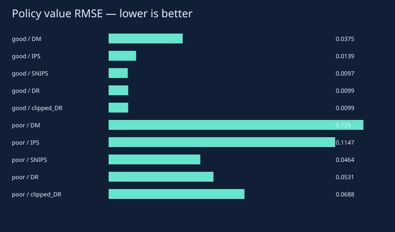
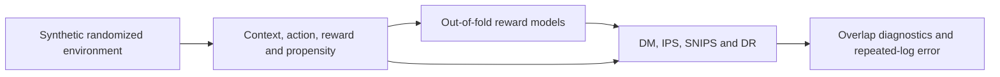

# Policy Counterfactuals

**Evaluate decisions from somebody else’s logs.**

[](https://github.com/aymaw/policy-counterfactuals/actions/workflows/ci.yml)
[](LICENSE)




New original, AI-assisted personal work, November 2026. All task data are synthetic.
No API key, pretrained download or private data is required. See [provenance](PROVENANCE.md).

## Run it

```bash
# Python 3.11–3.13. uv.lock freezes the dependency graph.
uv sync --frozen --extra dev
uv run pytest -q
uv run python -m policylab.experiment --out runs/reference
uv run python -m http.server 8765 --bind 127.0.0.1
```

Open `http://127.0.0.1:8765/runs/reference/demo.html` for the new run, or
`http://127.0.0.1:8765/results/demo.html` for the committed measured report.
The self-contained HTML also opens directly from disk. Stop the local server with Ctrl+C.

For a short correctness run, add `--quick --out runs/smoke`. Quick output is explicitly
labeled and is not the committed reference result. Training and checkpoints stay in
ignored `runs/`; reports include seeds/configuration, raw metrics and environment details.

## Inside the experiment

A fictional three-action contextual bandit logs only the selected action and its
binary reward. The randomized logging policy supplies the known probability of
every action. A fixed context-only target policy is evaluated with five estimators:

| Estimator | Implemented form |
| --- | --- |
| Direct method (DM) | mean of `sum_a pi(a|x) q(x,a)` |
| IPS | mean of `pi(a_logged|x) / behavior(a_logged|x) * reward` |
| Self-normalized IPS | weighted reward sum divided by weight sum |
| Doubly robust (DR) | DM plus mean of `weight * (reward - q(x,a_logged))` |
| Clipped DR | same expression with weights capped at 10; biased sensitivity comparison |

The reward model is a deliberately misspecified linear ridge fit. Five-fold
cross-fitting ensures that every reward prediction is made by a model trained
without that row's fold. The target is fixed before observing logged rewards;
its formula uses the synthetic environment's known context-to-score function.
It is not a policy learned from held-out outcome labels.



## Measured result

| Overlap | Estimator | Mean value | Bias | RMSE |
| --- | --- | --- | --- | --- |
| good | DM | 0.6507 | -0.0364 | 0.0375 |
| good | IPS | 0.6893 | 0.0021 | 0.0139 |
| good | SNIPS | 0.6892 | 0.0021 | 0.0097 |
| good | DR | 0.69 | 0.0028 | 0.0099 |
| good | clipped_DR | 0.69 | 0.0028 | 0.0099 |
| poor | DM | 0.559 | -0.1282 | 0.129 |
| poor | IPS | 0.7006 | 0.0135 | 0.1147 |
| poor | SNIPS | 0.6932 | 0.0061 | 0.0464 |
| poor | DR | 0.7029 | 0.0157 | 0.0531 |
| poor | clipped_DR | 0.6209 | -0.0663 | 0.0688 |

Oracle target value: 0.68715; independent Monte Carlo SE 0.00043.


The reference experiment uses 30 independent logs of 6,000 decisions for each of
two overlap regimes. Good/poor regimes favor the less rewarding actions with
different strengths and minimum action probabilities. Oracle population value is
approximated using 100,000 independent contexts; its Monte Carlo SE is reported.
Mean error and RMSE use the same fixed population target, not per-log estimated truth.

## Visual demo

Switch overlap regimes and scrub independent logs. Inspect estimates against the
oracle line, raw-weight effective sample size, maximum weight and the weak-overlap
flag. Error bars are 1.96 times the empirical standard error of the row-level score.
They are normal approximations; the report includes their empirical coverage.
DM's bars omit nuisance-model fitting uncertainty and are intentionally insufficient.
No interval is drawn for SNIPS or clipped DR.

## Tests and limits

Tests check hand-calculated estimators, on-policy reduction, zero-support rejection,
out-of-fold isolation, clipping diagnostics, and repeated-log unbiasedness with
correct known propensities. Weak overlap is flagged when ESS/n < 0.2; it is an
engineering heuristic rather than a theorem. Clipping removes the exact unbiasedness
property and can materially bias value estimates. Standard errors are diagnostics,
not a finite-sample guarantee; repeated-log coverage can be substantially below 95%.
This assumes randomized logged actions, consistency and positivity. Observational
confounding, longitudinal decisions and policy optimization are outside scope.
No patient, financial or real-world decision policy is being evaluated.

## Method reference

[Dudik, Langford & Li, Doubly Robust Policy Evaluation and Learning](https://arxiv.org/abs/1103.4601).

## Code map

- `src/policylab/core.py`: mathematical and inference primitives.
- `src/policylab/experiment.py`: seeded experiment and CLI.
- `src/policylab/visual.py`: dependency-free HTML/SVG reports.
- `tests/`: mathematical checks and failure-path regressions.
- `results/`: executed measurements, static preview, interactive report and provenance.
- `.github/workflows/ci.yml`: frozen install, lint, tests, quick experiment and package build on three Python versions.

Original implementation and generated fixtures: [MIT](LICENSE).
